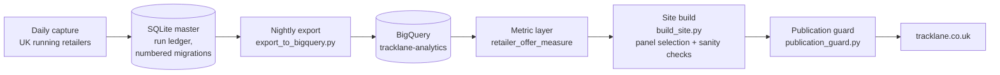

# Tracklane

**A daily UK running-shoe markdown index, built to refuse to publish a number it can't defend.**

Live at **[tracklane.co.uk](https://tracklane.co.uk/)**. Designed, built and run solo.

Tracklane tracks around 3,100 running shoes across 13 brands at UK retailers every day and publishes one headline figure: the share of shoes priced below the first price Tracklane recorded for them. The interesting part isn't the scraping. It's everything between "rows landed in a table" and "a number appeared on a public page".

This repository is a curated public extract of a private production codebase. It contains the data-quality, warehouse and publication layers. Collection code, retailer-specific parsers and the product catalogue stay private.

---

## The question it answers

Retailers show a "was" price on most sale shoes. Tracklane asks whether those shoes are actually cheaper.

| Data to 15 Nov 2026 | Share of tracked shoes |
|---|---|
| Show a retailer "was" price | 84.6% |
| Actually below the first price Tracklane recorded | 33.9% |

That gap is why the index never uses retailers' sticker prices. A markdown counts only against Tracklane's own first-seen price for the exact model at that retailer.

---

## Architecture

- **SQLite is the master; BigQuery is the analysis copy.** The exporter reads the database read-only and replaces each BigQuery table with a full fresh copy, so the warehouse can always be rebuilt from source.
- **Schema changes only go through numbered migrations**, never ad hoc `ALTER TABLE` inside a scraper.
- **The homepage is generated from BigQuery SQL** (`COUNTIF` numerators and denominators, `PERCENTILE_CONT` medians and p90) and deployed to Netlify only after every check passes.

---

## How a number earns its place on the page

Each rule below exists because a quieter failure mode was found first.

**1. A partial run is not a quiet day** ([`pipeline/run_ledger.py`](pipeline/run_ledger.py))
A scraper that failed halfway through pagination used to write a partial set of rows and exit cleanly. Downstream, that looked identical to a real drop in range, and row-count checks can't tell them apart. So every run now records `start → complete | fail` at write time. A run left in `running` is itself a finding, and published figures may only read completed runs.

**2. Only verified retailer-days count** ([`site_builder/build_site.py`](site_builder/build_site.py))
A retailer joins the headline rate only if it is verified today *and* on at least 12 of the last 14 days. Retailers outside the panel are still shown, clearly labelled "not yet in the rate", so coverage gaps are disclosed rather than hidden.

**3. Refuse to build rather than publish something wrong**
The build exits without writing anything, and the live site keeps its last good version, if:
- the newest verified data is more than 2 days old
- fewer than 1,000 shoes sit in the headline denominator
- no retailer qualifies for the panel
- any rate falls outside 0–100%

**4. Published history can't silently change** ([`site_builder/publication_guard.py`](site_builder/publication_guard.py))
Before replacing the live page, the guard checks that every previously published chart point is unchanged, that the retailer panel hasn't shifted without review, and that the newest point is today's. A restatement has to be a deliberate, reviewed release.

**5. Validate the candidate, not yesterday's file** ([`pipeline/publish.py`](pipeline/publish.py))
The obvious fix, running validation before the report build, would have audited yesterday's published file rather than today's, and the validator exited cleanly even when it never ran. The four-phase publisher validates the data, builds a candidate, validates the candidate, then promotes it atomically and keeps the previous version for rollback.

---

## Metric definitions

| Measure | Definition |
|---|---|
| **Markdown rate** | Shoes priced below their first-seen price ÷ all shoes with a verified price that day |
| **Exact model** | Brand, model, generation, gender and width. Clifton 10 and Clifton 11 are different shoes |
| **Sale label** | Share of the same shoes showing a retailer "was" price. Shown for comparison, never used in the rate |
| **Verified day** | The retailer's capture passed checks and both measures have metric-ready rows |
| **Depth** | Median and 90th-percentile cut on marked-down shoes |

History starts on 23 October 2026, so early markdowns are understated: a shoe already discounted when first seen counts as full price until it drops further.

---

## What's in this repo

| Path | What it shows |
|---|---|
| `pipeline/run_ledger.py` | Run-outcome ledger and the single definition of which runs a figure may read |
| `pipeline/publish.py` | Four-phase validate → build → validate → promote publisher with rollback |
| `pipeline/export_to_bigquery.py` | Read-only nightly SQLite → BigQuery export (EU region) |
| `site_builder/build_site.py` | BigQuery SQL, panel selection, sanity checks and homepage build |
| `site_builder/publication_guard.py` | Append-only check on published chart history |
| `migrations/007_run_ledger_and_colourway_key.sql` | Example additive schema migration |

These files are extracted as-is, so some import modules that remain private.

**Stack:** Python, SQL (SQLite, BigQuery), Google Cloud, PythonAnywhere scheduling, Netlify.

---

Ethan Abraham · [LinkedIn](http://www.linkedin.com/in/ethan-abraham) · Code shared for review; all rights reserved.
